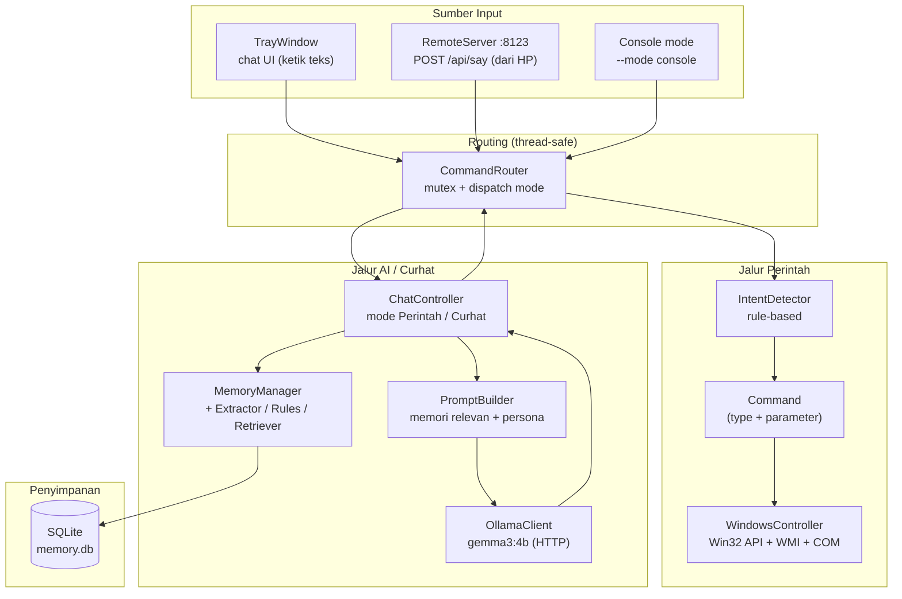
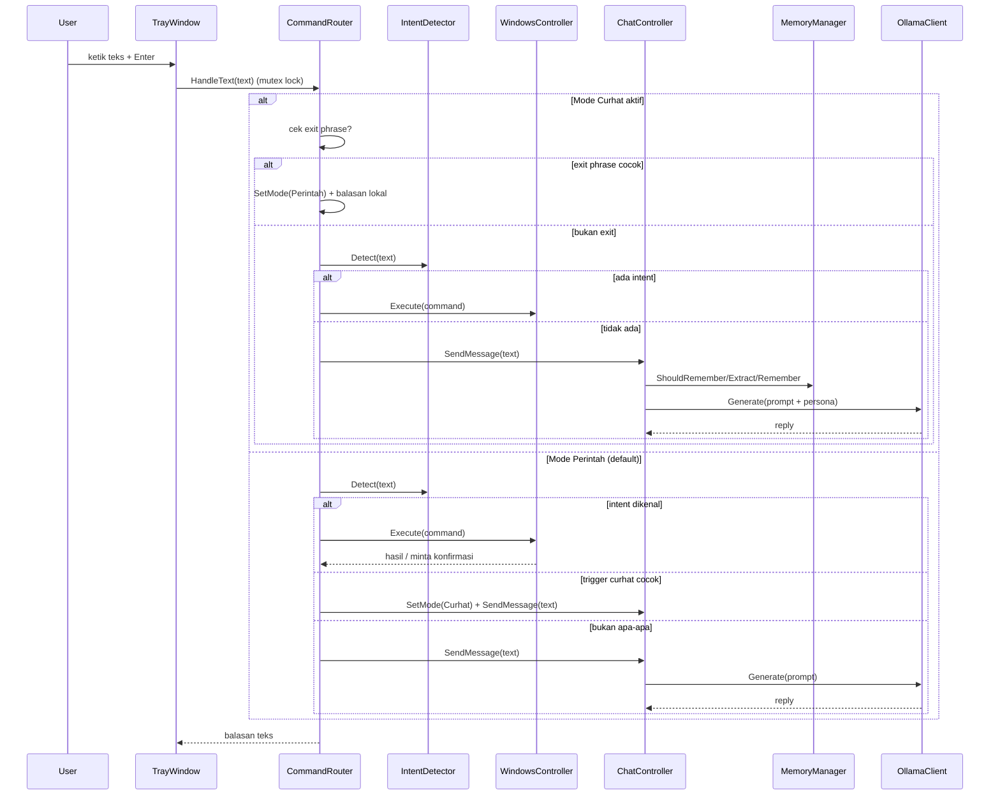
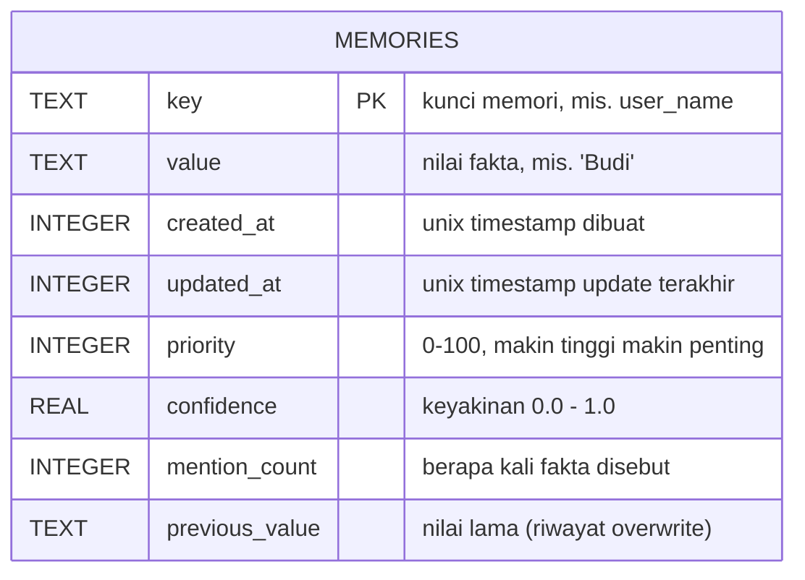
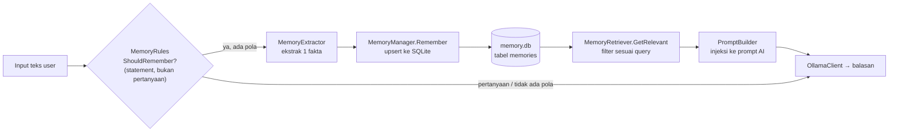

# Yuki - Text-Based AI Personal Assistant (My istri) belum siap njir
*Project iseng project mandiri*

<p align="center">
  
</p>

Yuki adalah asisten AI personal berbahasa Indonesia yang berjalan sebagai **system tray app** di Windows. Interaksi dan seluruh balasan aplikasi utama menggunakan **teks** melalui jendela chat atau mode console. Fitur lain mencakup mode curhat dengan AI lokal (Ollama), memori jangka panjang (SQLite), eksekusi perintah Windows via intent rule-based, dan server remote HTTP.

> Status: masih proyek iseng / belum rilis. Komponen suara *masuk* (Whisper STT, wake word, speaker verification) sudah ditulis dan di-*test*, tapi **belum diintegrasikan ke binary utama** — input sekarang masih teks.

---

## 🌟 Fitur Utama (yang sudah jalan di binary utama)

- **Tray Chat UI**: App berjalan di *system tray* (Win32 native, dark theme). Klik ikon → jendela chat kecil (riwayat percakapan + input teks + tombol send). Tekan Enter untuk kirim.
- **Dual Conversation Mode**:
  - **Mode Perintah** (default) — hanya menjalankan intent Windows yang dikenali. Input tidak dikenal ditolak singkat dan tidak dikirim ke Ollama. Berpindah secara eksplisit dengan `/curhat`.
  - **Mode Curhat** — pesan percakapan dikirim ke Ollama dengan persona Yukihana dan memori SQLite yang relevan. Isi percakapan tidak diteruskan ke intent Windows. Berpindah kembali dengan `/perintah`; `/mode` menampilkan mode aktif.
- **Eksekusi Perintah Windows**: Shutdown/Restart/Sleep/Lock/Logout (dengan konfirmasi), buka VS Code/Steam/Explorer, buka web (YouTube Music, GitHub, Facebook, ChatGPT, dll), screenshot, volume (COM `endpointvolume`), brightness (WMI + gamma ramp fallback), wifi on/off, dan `PlaySong` (YouTube).
- **Memori Jangka Panjang (SQLite)**: Fakta dari percakapan (nama, kota, kampus, kesukaan) diekstrak dengan pola → disimpan di `memory.db` → diambil relevan saat prompt dibangun (smart retrieval).
- **Ollama Integration (AI Lokal)**: `gemma3:4b` lewat HTTP, privasi terjaga, tanpa API eksternal. Dibungkus interface `AIBackend` agar mudah ganti backend.
- **Server Remote (LAN)**: HTTP server minimal (Winsock) di port `8123` — `GET /api/health`, `POST /api/say`, otorisasi opsional via header `X-Yuki-Token`, CORS `*`. Thread-safe karena memakai `CommandRouter`.
- **Output teks**: Balasan ditampilkan di jendela chat atau console. Target aplikasi utama tidak membuat objek TTS dan tidak menautkan Windows SAPI.
- **Normalisasi & Fuzzy Matching**: `TextNormalizer` + `Utf8Sanitizer` untuk membersihkan input, `StringFuzzy` (Levenshtein) untuk toleransi kesalahan ketik pada trigger/exit phrase.

### 🧊 Komponen "dormant" (kode + unit test ada, belum masuk binary utama)

- `TextToSpeech` — source SAPI dipertahankan untuk target tes terpisah; tidak ditautkan ke aplikasi utama.
- `WhisperRecognizer` (whisper.cpp, model `base`) — Speech-to-Text.
- `VoiceSession` — state machine push-to-talk / always-on (wake word); source-nya tetap memakai TTS, tetapi tidak masuk target aplikasi utama.
- `WakeWordDetector` — deteksi kata "yuki".
- `MfccExtractor` + `SpeakerVerifier` — verifikasi suara berbasis DSP (MFCC + cosine similarity), ada test sintetis.

---

## 🏗️ Arsitektur Aplikasi

### Komponen utama



### Alur satu pesan (mode tray)



---

## 🗄️ Arsitektur Database

### Skema & relasi

Database `memory.db` (SQLite) dipakai untuk **memori jangka panjang** — saat ini hanya satu tabel: `memories` (key-value dengan metadata). Schema dibuat otomatis saat aplikasi pertama kali jalan (`SQLiteMemoryStorage`), lengkap dengan migrasi kolom via `ALTER TABLE`.



**Daftar kunci memori yang dikenal** (dari `MemoryPatterns.h`):

| Key | Kategori | Priority | Contoh pemicu pola |
|-----|----------|----------|--------------------|
| `user_name` | Identity | 100 | "nama saya", "namaku", "aku" |
| `user_city` | Location | 90 | "aku berasal dari", "rumahku di" |
| `university` | Education | 85 | "aku kuliah di", "aku mahasiswa" |
| `favorite` | Preferences | 70–75 | "aku suka", "makanan favoritku", "hobiku" |

### Perilaku kolom

- **Upsert** (`INSERT ... ON CONFLICT(key) DO UPDATE`): saat key sudah ada, `value`/`priority`/`confidence` di-update, `updated_at` di-set ke waktu sekarang, `mention_count` ditambah 1, dan nilai lama disalin ke `previous_value`. `created_at` dipertahankan (tidak direset).
- **Penyortiran saat diambil** (`LoadAll`): `ORDER BY priority DESC, updated_at DESC` — fakta penting & terbaru muncul pertama.
- **Smart retrieval** (`MemoryRetriever::GetRelevant`): query yang mengandung kata kunci (mis. "tinggal", "suka", "kuliah") hanya mengembalikan key relevan. Tanpa kata kunci → fallback ke prioritas ≥ 70, atau top-3 bila tidak ada.

### Pipeline memori



---

## 📂 Struktur Direktori (kondisi aktual)

Proyek ini menggunakan **C++17** dengan struktur modular:

```text
Yuki/
├── CMakeLists.txt          # Build CMake: target Yuki + banyak target unit test
├── .gitignore              # Build/, *.db, .vscode/
├── config/
│   └── config.json          # Pengaturan backend, memori, system, remote, persona, dan voice legacy
├── src/                     # Source code utama
│   ├── main.cpp             # Entry point — mode: tray (default) / console (--mode console)
│   ├── ai/                  # AIBackend (interface) + OllamaClient (HTTP ke Ollama)
│   ├── audio/               # MfccExtractor + SpeakerVerifier (dormant, dipakai unit test)
│   ├── chat/                # ChatController, CommandRouter, Conversation, PromptBuilder
│   ├── config/              # Struct Config + ConfigManager (load/parse JSON)
│   ├── core/                # Application (legacy, belum terpakai di binary utama)
│   ├── memory/              # MemoryManager, SQLiteMemoryStorage, MemoryExtractor,
│   │                        #   MemoryRules, MemoryRetriever, MemoryPatterns
│   ├── remote/              # RemoteServer (HTTP server Winsock, port 8123)
│   ├── system/              # Command, IntentDetector, WindowsController
│   ├── tray/                # TrayIcon (komponen ikon tray)
│   ├── ui/                  # TrayWindow (jendela chat utama) + MainWindow (legacy)
│   ├── utils/               # TextNormalizer, Utf8Sanitizer, StringFuzzy, HttpClient, Json, Logger, AudioResampler
│   └── voice/               # Source TTS dipertahankan untuk tes; Whisper dan VoiceSession dormant
├── tests/                   # ±30 executable unit test (Intent, Memory, Chat, Voice, Audio, Remote, Config, dll)
└── third_party/             # nlohmann/json, sqlite (amalgamation), whisper.cpp
```

> `memory.db` tidak di-commit (ada di `.gitignore`).

---

## 🚀 Alur Kerja Aplikasi (tray mode)

1. **Input**: User menekan Enter di input box jendela chat (atau mengirim `POST /api/say` dari HP ke `RemoteServer`).
2. **Routing**: `CommandRouter::HandleText` (dilindungi mutex — aman dari thread UI & server) memilih jalur sesuai mode.
3. **Mode Perintah**: intent dikenali lalu dijalankan langsung; intent berisiko meminta konfirmasi. Teks tidak dikenal tidak memanggil Ollama.
4. **Mode Curhat**: pesan percakapan menggunakan Ollama dan memori relevan; router tidak menjalankan intent Windows berdasarkan isi pesan.
5. **Ekstraksi Memori**: kalau pernyataan mengandung pola fakta (bukan pertanyaan), fakta di-*upsert* ke `memory.db`.
6. **AI Processing**: `PromptBuilder` menyusun prompt (memori relevan + persona + riwayat percakapan) → `OllamaClient` menghasilkan balasan.
7. **Sanitasi**: tag sisa `[CMD:...]` dari model dibuang (tidak pernah dieksekusi).
8. **Output**: Balasan ditampilkan sebagai teks di chat log atau console.

---

## 🛠️ Prasyarat & Teknologi

- **Bahasa**: C++17 (RAII + smart pointer di seluruh codebase)
- **Build**: CMake (≥ 3.21), MSVC atau MinGW
- **AI Backend**: [Ollama](https://ollama.com) — model default `gemma3:4b` (bisa ganti di `config.json`)
- **Speech-to-Text** *(dormant)*: whisper.cpp (`ggml-base.bin`)
- **Database**: SQLite3 (amalgamation di `third_party/sqlite`)
- **TTS**: Source dan target tes TTS tetap tersedia, tetapi tidak digunakan atau ditautkan oleh target aplikasi utama.
- **UI**: Win32 API native (tray icon + window), tanpa framework GUI berat
- **HTTP**: WinHTTP (`HttpClient`), Winsock (`RemoteServer`)
- **OS Target**: Windows

---

## 🧪 Testing

Tersedia banyak target unit test di CMake (mis. `SystemTest`, `MemoryTest`, `ExtractorTest`, `RetrieverTest`, `PromptBuilderTest`, `ModeTransitionTest`, `NoAICmdExecutionTest`, `RemoteServerTest`, `SpeakerVerifierTest`, `MfccExtractorTest`, `WakeWordTest`, `TextToSpeechTest`, `ConfigTest`, `BrightnessIntentTest`, dll). Build & jalankan langsung dari executable masing-masing di `build/bin`.

---

## 🔧 Roadmap

- [x] Dual mode routing (Perintah/Curhat) + fuzzy trigger/exit phrase.
- [x] Eksekusi perintah desktop (system, app, web, volume, brightness, wifi, screenshot, play song).
- [x] Memori jangka panjang: ekstraksi pola → SQLite → smart retrieval → injeksi prompt.
- [x] Remote server HTTP untuk kontrol dari HP dalam LAN.
- [x] Tray chat UI (dark theme) dengan output teks.
- [x] ~~Wake word~~ — implementasi ada, tapi di-nonaktifkan (input sekarang lewat ketik/chat).
- [x] ~~Low latency audio~~ — buffer reuse, VAD hysteresis, resampler (di komponen voice dormant).
- [ ] Integrasi Whisper STT ke binary utama (input suara → chat).
- [ ] Aktifkan speaker verification di aplikasi (baru unit test sintetis).
- [ ] Voice level meter di UI.
- [ ] Audit intent matching yang rawan false-positive (OpenVSCode, OpenExplorer, Screenshot, Lock).
- [ ] Tuning threshold speaker verification di kondisi ruangan nyata.
- [ ] Evaluasi upgrade model Whisper ke `small` bila akurasi `base` kurang.
- [ ] Analisis sentimen suara real-time.
- [ ] Custom tray icon (masih placeholder).

---

## 🐛 Known Issues

- Beberapa intent (`OpenVSCode`, `OpenExplorer`, `Screenshot`, `Lock`) memakai keyword yang umum dan berpotensi false-positive.
- `no_speech_prob` dari Whisper tidak selalu mencerminkan akurasi transkrip (relevan saat STT aktif).
- `RemoteServer` tidak memakai TLS — hanya aman di LAN tepercaya; token dikirim plaintext via header.
- `Application`/`MainWindow` di `src/core` & `src/ui` masih ter-compile tapi belum dipakai (dead code).
- Whisper/wake word/speaker verification belum tersambung ke UI utama.

## Windows 11 quick start

Jalankan perintah dari root repository, karena konfigurasi dan database memakai path relatif:

```powershell
cmake -S . -B build -G "MinGW Makefiles"
cmake --build build --target Yuki --parallel
.\build\bin\Yuki.exe --mode console
```

Pastikan Ollama berjalan dan `gemma3:4b` tersedia (`ollama list`). Console mulai di Mode Perintah; gunakan `/curhat` untuk chat AI, `/perintah` untuk kembali, dan `/mode` untuk melihat mode aktif. Tanpa argumen mode, aplikasi menggunakan `ui_mode` dari konfigurasi.

Remote HTTP berjalan hanya pada tray mode ketika `remote.enabled` aktif. Kontraknya `GET /api/health` dan `POST /api/say` dengan JSON `{"text":"..."}`; respons chat memakai field `reply`. Jika token dikonfigurasi, client mengirim header `X-Yuki-Token` yang sama. Token kosong berarti endpoint tidak meminta autentikasi.
