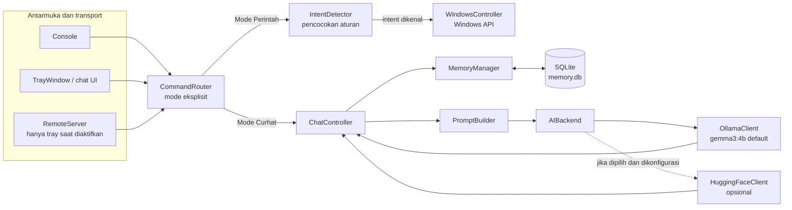

# Yukihana (Yuki)

<p align="center">
  
</p>

<p align="center"><strong>Asisten AI desktop berbasis teks untuk Windows</strong><br>Mode Perintah berbasis intent, Mode Curhat dengan Ollama, dan memori jangka panjang SQLite.</p>

---

## Tentang proyek

Yukihana adalah asisten AI pribadi berbahasa Indonesia yang dikembangkan dengan C++17 dan Win32. Aplikasi utama dapat dijalankan dari system tray atau console. Pengguna memilih sendiri kapan Yuki menjalankan perintah Windows dan kapan ia mengobrol lewat model AI.

Proyek ini masih dikembangkan. README ini menjelaskan perilaku yang ditemukan pada source dan konfigurasi repository, termasuk komponen legacy yang sengaja masih disimpan.

## Fitur utama

| Area | Yang tersedia |
|---|---|
| Antarmuka | Jendela chat Win32 dari system tray dan mode console; seluruh interaksi aplikasi utama berbasis teks. |
| Mode Perintah | Intent Windows yang dikenali dijalankan secara lokal. Input yang tidak dikenali ditolak tanpa memanggil AI. Aksi tertentu meminta konfirmasi. |
| Mode Curhat | Pesan dikirim ke backend AI, memakai persona Yukihana dan fakta memori yang relevan. Isi chat tidak dirutekan ke intent Windows. |
| AI | Ollama dengan model default `gemma3:4b`, melalui HTTP lokal. Backend Hugging Face juga tersedia jika dikonfigurasi dengan model, endpoint, dan token lingkungan. |
| Memori | Fakta yang dikenali disimpan di SQLite (`memory.db`) dan dipilih sesuai relevansi prompt. Batas riwayat prompt tidak menghapus fakta SQLite; riwayat chat mengikuti lifetime aplikasi. |
| Perintah desktop | Informasi sistem dan tanggal/waktu; membuka aplikasi, folder, dan situs; kontrol volume dan kecerahan; serta beberapa tindakan sistem. |
| Remote HTTP | Endpoint LAN `/api/health` dan `/api/say`, jika diaktifkan di konfigurasi. Meneruskan pesan melalui router yang sama. |
| Diagnostik AI | Log mencatat durasi penyusunan prompt, ukuran prompt dalam byte, durasi total `SendMessage()`, serta metrik token dan waktu dari respons Ollama bila tersedia. Isi prompt, chat, dan memori tidak dicetak oleh log metrik ini. |

### Perintah desktop yang dikenali

Intent yang saat ini tercantum di source meliputi sleep, shutdown, restart, lock, logout, membuka PowerShell atau Command Prompt, Notepad, WhatsApp, Microsoft Word, VS Code, File Explorer, Chrome, Steam, GitHub, YouTube Music, serta situs seperti ChatGPT, Claude, Facebook, TikTok, Instagram, YouTube, dan SMILE UNP. Tersedia juga informasi sistem, tanggal/waktu, cuaca rumah/kampus, volume, kecerahan, Wi-Fi, screenshot, dan pencarian lagu.

Ketersediaan aplikasi dan keberhasilan tindakan bergantung pada perangkat Windows. Shutdown, restart, dan sleep meminta konfirmasi melalui router.

## Mode percakapan

Mode tidak berubah otomatis berdasarkan kata di dalam pesan. Gunakan perintah eksplisit berikut:

| Input | Hasil |
|---|---|
| `/mode` | Menampilkan mode aktif. |
| `/curhat` | Beralih ke Mode Curhat. Pesan berikutnya dikirim ke AI. |
| `/perintah` | Beralih ke Mode Perintah. Hanya intent yang dikenali yang dijalankan. |

Console dimulai pada Mode Perintah. Dalam Mode Curhat, Yuki tidak menjalankan intent Windows dari isi percakapan. Dalam Mode Perintah, input yang tidak cocok dengan intent menghasilkan pesan singkat dan tidak diteruskan ke Ollama.

## Arsitektur



`main.cpp` membuat router, backend, memori, pengendali Windows, dan antarmuka. `CommandRouter` memisahkan jalur berdasarkan mode aktif. Jalur Perintah menggunakan `IntentDetector` dan `WindowsController`; jalur Curhat memanggil `ChatController`, yang menyusun prompt sebelum mengirimkannya ke backend.

### Prompt dan riwayat

`PromptBuilder` merangkai persona dasar, instruksi kerja, instruksi Mode Curhat, memori relevan, dan riwayat percakapan. Batas riwayat diatur lewat `conversation.max_history_turns` di `config/config.json` dengan nilai awal 6 giliran. Batas ini hanya menentukan pesan yang disertakan saat menyusun prompt; tidak menghapus fakta dari SQLite. Riwayat chat percakapan berada di memori proses. Pesan terbaru tetap disertakan dan urutannya dipertahankan. Fakta memori yang sudah tampak di konteks user terbaru dapat dilewati untuk mengurangi duplikasi.

### Memori SQLite

Database lokal memakai tabel `memories` untuk fakta terstruktur seperti identitas, lokasi, pendidikan, dan preferensi. Fakta dikenali oleh aturan ekstraksi, disimpan dengan operasi upsert, lalu dipilih menurut relevansi pertanyaan saat prompt disusun. File database lokal diabaikan oleh Git; jaga salinan cadangannya sendiri.

## Perubahan yang sudah diterapkan

Ringkasan ini mencatat perubahan yang terlihat di repository saat dokumentasi diperbarui:

- Mode Perintah dan Mode Curhat dipisahkan secara eksplisit. Mode Perintah tidak mengirim input biasa atau perintah yang tidak dikenal ke AI; Mode Curhat tidak menjalankan intent Windows.
- Perpindahan mode memakai `/perintah`, `/curhat`, dan `/mode`.
- Riwayat prompt dibatasi oleh `conversation.max_history_turns` (default 6); ini membatasi konteks model, bukan menghapus riwayat sesi di proses atau fakta SQLite.
- Logging performa prompt dan respons AI ditambahkan tanpa mencetak isi prompt atau data pribadi.
- Persona Yukihana dan instruksi teknis disusun terpisah dalam prompt; persona digunakan pada jalur Curhat.
- Target aplikasi utama bersifat text-only: source TTS tidak menjadi bagian runtime utama dan target `Yuki` tidak menautkan SAPI.
- Intent desktop diperluas, termasuk perintah aplikasi/situs, cuaca rumah dan kampus, SMILE UNP, informasi sistem, tanggal/waktu, volume, dan kecerahan.
- Perbaikan CMake untuk target tes dan fixture routing dicatat pada [PROJECT_CLEANUP_AUDIT.md](PROJECT_CLEANUP_AUDIT.md).

### Yang dibersihkan dan yang sengaja dipertahankan

Audit cleanup menghapus direktori build sementara `build_commandcheck/`, `build_weathercheck/`, `build_elearning_check/`, dan file diagnostik `debug.log`. Pola artefak tersebut ditambahkan ke `.gitignore`.

Tidak ada source TTS/Whisper, file eksperimen training, model Whisper, database, konfigurasi, atau dependensi vendor yang dihapus dalam cleanup tersebut. Source suara masih tersedia untuk target tes atau komponen dormant; keberadaannya tidak berarti fitur itu aktif di aplikasi utama. Folder `build/` juga dipertahankan.

## Struktur repository

```text
Yuki/
├── CMakeLists.txt          # Target aplikasi dan unit test
├── config/config.json      # Backend, model, mode UI, memori, remote, persona
├── src/
│   ├── main.cpp            # Entry point; memilih tray atau console
│   ├── ai/                 # Interface backend, Ollama, Hugging Face
│   ├── chat/               # ChatController, CommandRouter, Conversation, PromptBuilder
│   ├── config/             # Struktur konfigurasi dan pemuat JSON
│   ├── core/               # Application; masih tercantum dalam target
│   ├── memory/             # Ekstraksi, aturan, retrieval, dan SQLite
│   ├── remote/              # RemoteServer HTTP berbasis Winsock
│   ├── system/              # IntentDetector dan WindowsController
│   ├── ui/                  # TrayWindow dan MainWindow
│   ├── voice/               # Source suara dormant/legacy, tidak aktif di runtime utama
│   ├── audio/               # Pemrosesan audio dan verifikasi speaker
│   └── utils/               # HTTP, JSON, logging, normalisasi, dan utilitas
├── tests/                  # Unit test berbagai komponen
├── third_party/            # SQLite, nlohmann/json, dan whisper.cpp
├── training/               # Skrip, notebook, dan dataset eksperimen
├── memory.db               # Database lokal; tidak dilacak Git
└── PROJECT_CLEANUP_AUDIT.md
```

Source dan model Whisper, modul suara, serta target tes terkait masih dipertahankan karena masih memiliki referensi. `src/core/Application.cpp` dan `src/ui/MainWindow.cpp` juga masih tercantum pada target build walau entry point saat ini membuat `TrayWindow`.

## Menjalankan di Windows 11

### Prasyarat

- Windows 11
- CMake 3.21 atau lebih baru
- Toolchain C++17, misalnya MinGW-w64 atau Visual Studio
- Ollama berjalan lokal dan model `gemma3:4b` tersedia untuk konfigurasi default

Periksa model Ollama dengan:

```powershell
ollama list
```

Jalankan perintah build dari root repository agar file konfigurasi dan database relatif ditemukan dengan benar.

### Build dengan MinGW

```powershell
cmake -S . -B build -G "MinGW Makefiles"
cmake --build build --target Yuki --parallel
```

### Jalankan console

```powershell
.\build\bin\Yuki.exe --mode console
```

Console mulai pada Mode Perintah. Ketik `/curhat` untuk mengobrol dengan AI, `/perintah` untuk kembali ke intent Windows, dan `/mode` untuk melihat mode. Ketik `exit` atau `keluar` untuk menutup aplikasi.

### Jalankan tray

Tanpa argumen `--mode`, aplikasi menggunakan `app.ui_mode` dari konfigurasi. Nilai repository saat ini adalah `tray`. Untuk menjalankan mode console, gunakan argumen di atas.

## Build dan tes

CMake menyediakan executable tes untuk komponen seperti routing, riwayat prompt, persona, konfigurasi, memori, remote server, dan modul audio/voice. Contoh membangun semua target:

```powershell
cmake --build build --parallel 4
```

Contoh menjalankan tes routing dan batas riwayat dari PowerShell:

```powershell
.\build\bin\ModeRoutingTest.exe
.\build\bin\PromptHistoryTest.exe
```

Nama executable yang tersedia bergantung pada konfigurasi generator dan hasil build.

## Remote HTTP

Server hanya dibuat dalam mode tray dan ketika `remote.enabled` aktif. Kontrak endpoint:

- `GET /api/health`
- `POST /api/say` dengan body JSON `{"text":"pesan"}`; respons berisi `reply`
- Jika `remote.token` diisi, autentikasi menggunakan header `X-Yuki-Token`

Pada konfigurasi repository, remote aktif di port `8123` dan token kosong. Dengan token kosong endpoint tidak meminta autentikasi. Server ini tidak memakai TLS; gunakan hanya pada jaringan tepercaya dan atur token sebelum membuka akses ke jaringan yang tidak sepenuhnya dipercaya. Jangan memetakan port ini langsung ke internet.

## Komponen dormant dan batasan

- **TTS/SAPI:** source dan tes terpisah masih ada, tetapi target aplikasi utama tidak membuat objek TTS dan tidak menautkan SAPI.
- **Whisper dan voice session:** source, konfigurasi, model, dan tes tetap ada; belum menjadi alur input runtime utama.
- **Backend Hugging Face:** dapat dipilih melalui konfigurasi bila model, endpoint, dan token environment tersedia; fallback-nya Ollama.
- **Remote:** HTTP tanpa TLS. Bila token kosong, endpoint tidak meminta autentikasi.
- **Windows intents:** keberhasilan membuka aplikasi, mengatur brightness, cuaca, atau fungsi sistem bergantung pada instalasi, perangkat keras, dan jaringan.
- **Integrasi perangkat nyata:** README tidak mengklaim pengujian pada perangkat Flutter atau seluruh lingkungan Windows pengguna.

## Kontribusi dan perubahan

Sebelum mengubah perilaku aplikasi, periksa `src/chat`, `src/system`, `src/config`, dan target terkait di `CMakeLists.txt`. Pertahankan pemisahan mode, data `memory.db`, konfigurasi remote, dan komponen dormant kecuali perubahan tersebut memang menjadi tujuan dan sudah ditinjau.
